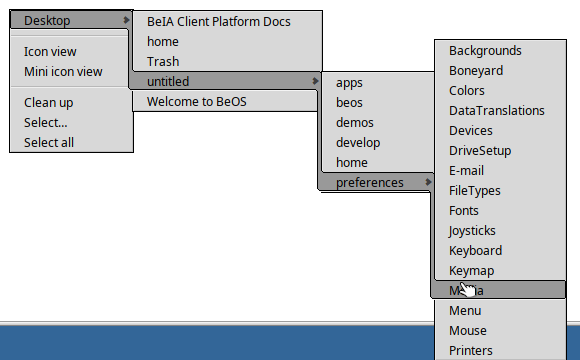
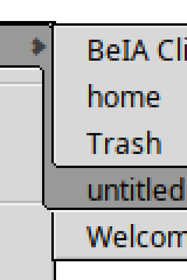
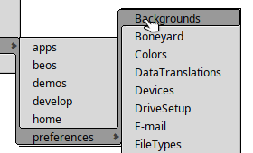
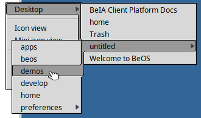
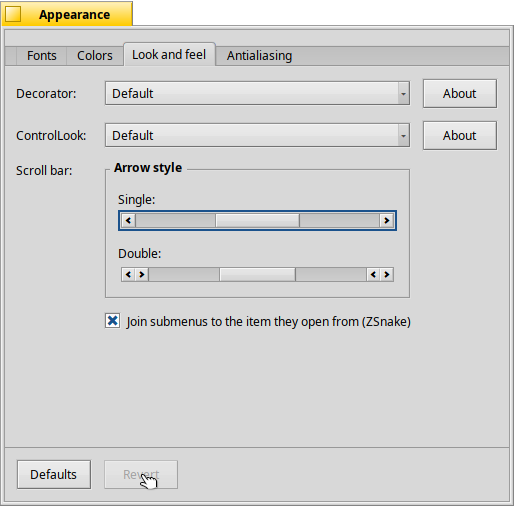
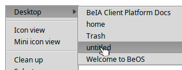
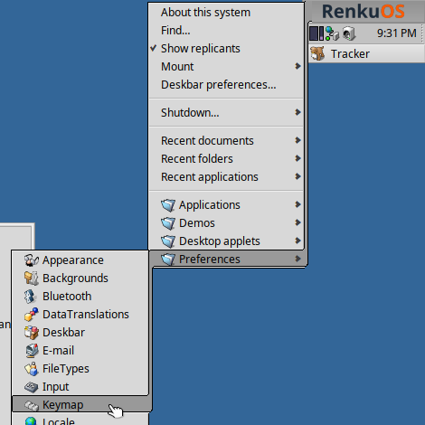
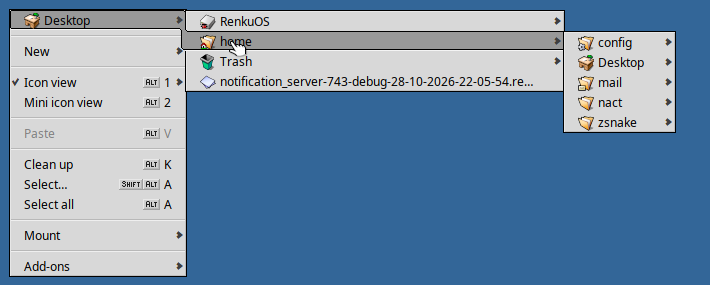
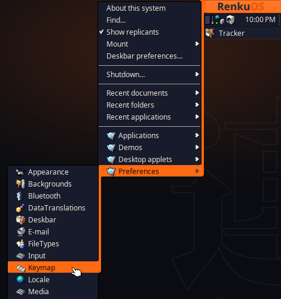
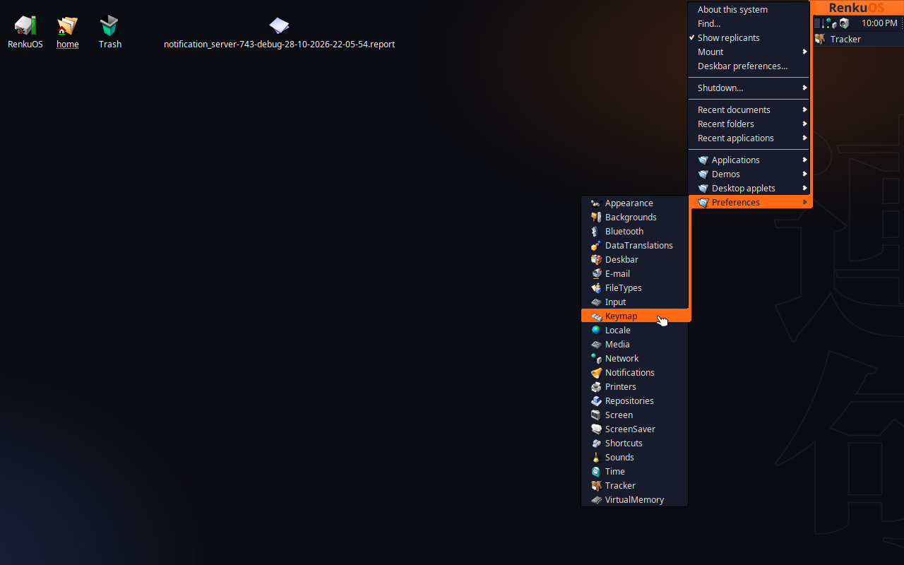

RenkuOS
=======================
[Homepage](https://github.com/RenkuOS)
| [Issue Tracker](https://github.com/RenkuOS/Source/issues)

RenkuOS is an open-source operating system that specifically targets personal
computing. Inspired by the BeOS and based off of Haiku.

Goals
------------
 * Sensible defaults with minimal configuration required.
 * Clean, clear, concise code.
 * Unified desktop environment.

Trying RenkuOS
---------------
RenkuOS is in pre-release stage, we are just getting started! We do provide pre-built [nightly images](https://github.com/RenkuOS/Source/releases/tag/nightly).

ZSnake (prototype, `zsnake` branch)
-----------------------------------
BeOS 5.1 "Dano" hid a menu effect called ZSnake in its Menu preferences: the
selection becomes one outlined path from a menu's item, down or up the open
submenu's edge, to the submenu's selected item, a step for each level. This
branch brings it to RenkuOS, drawn pixel for pixel as Dano drew it. Turn it on
in Appearance > Look and feel; it is off by default, as in Dano.

Each menu draws its own part of the path. The band runs inside the
supermenu's edge, crosses its border where the supermenu ends, and carries on
over whatever lies beside the submenu, as Dano's did. Menus with ZSnake on draw
their own border, so a selected item can open through it into the band.

| Close-up of a join (4×) | Upward | Flipped to the left |
|---|---|---|
|  |  |  |

| The switch in Appearance | ZSnake off: menus as before |
|---|---|
|  |  |

| Deskbar: from the button, through the Be menu, into a submenu | Tracker's desktop menu |
|---|---|
|  |  |

Under the Renku theme from [Power Theme](https://github.com/idumych/power-theme),
the path takes the theme's fire orange from the Deskbar's button down to
the selected item. The theme draws selected items' borders in the same
orange as their fill, so the path is one solid shape:

| Deskbar | The whole desktop |
|---|---|
|  |  |

The setting is a `zsnake` flag in `menu_info`, in the struct's padding, so its
size doesn't change; app_server saves it with the other menu settings. The
Deskbar's button takes the selection colour while its menu is open.

Tested on a RenkuOS nightly (hrev60072+398) in QEMU with this branch's libbe
and a test app: joins down, up, past the supermenu's end and flipped left,
four levels deep; ZSnake off unchanged; the Appearance switch, Defaults and
Revert, picked up by newly started apps. This branch's Deskbar and Tracker
(with its libbe and libtracker) were run in place of the system's, with the
flag forced on in a test build because the nightly's app_server doesn't keep
it: the Deskbar button and Be menu, its submenus, and Tracker's desktop menu.
Not yet run: app_server saving the setting across reboots, which needs an
image built from this branch; and a gcc2 build.

Contributing
-------------------
Contributions are welcome! More details to be added soon. 
